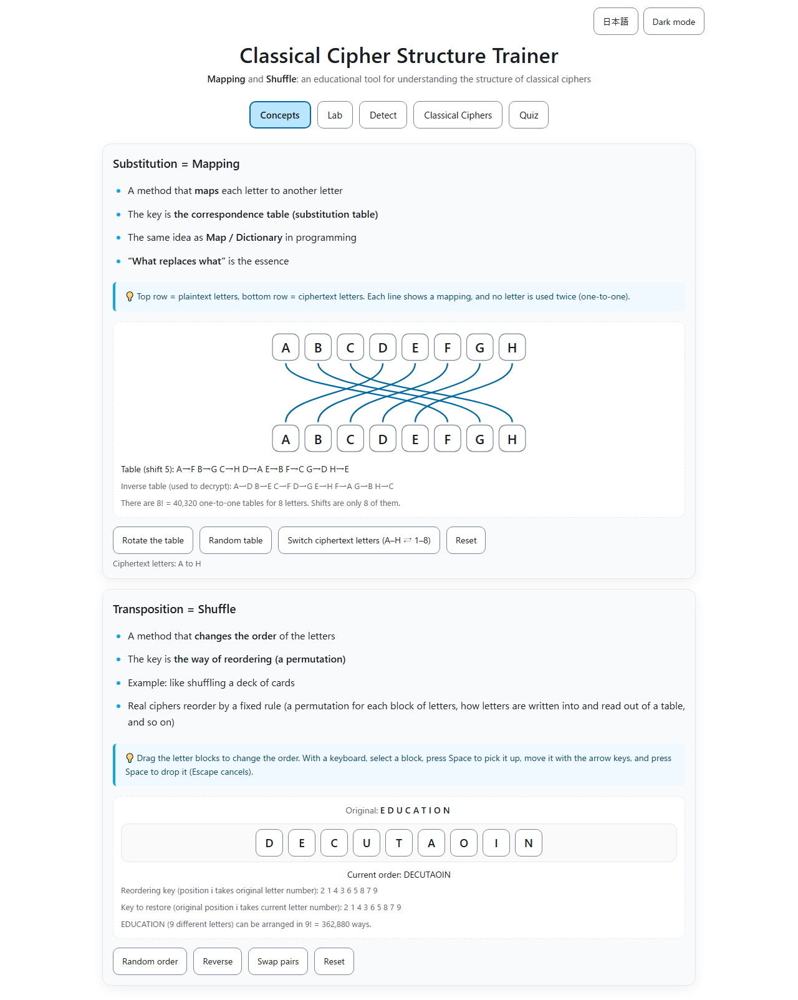
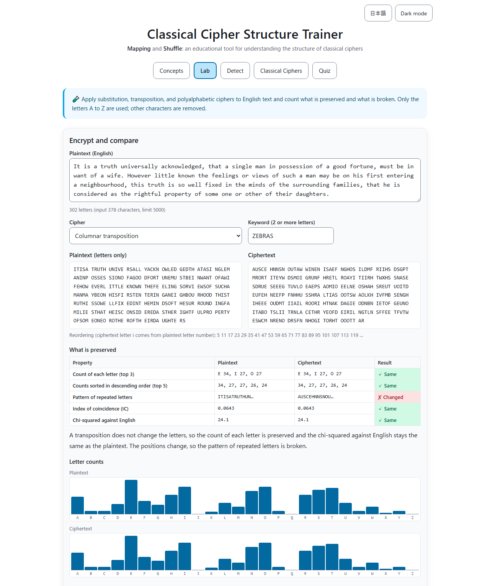
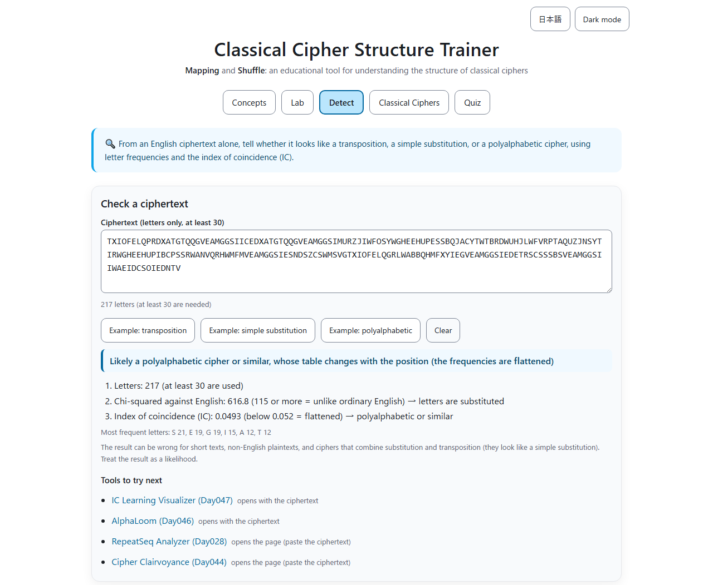
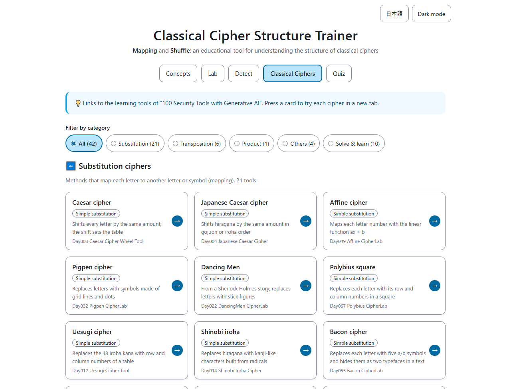
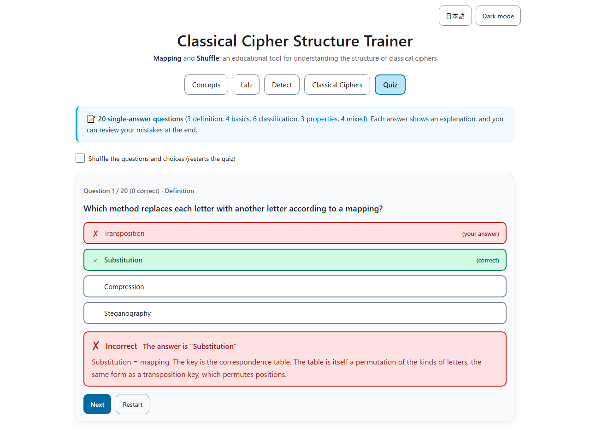
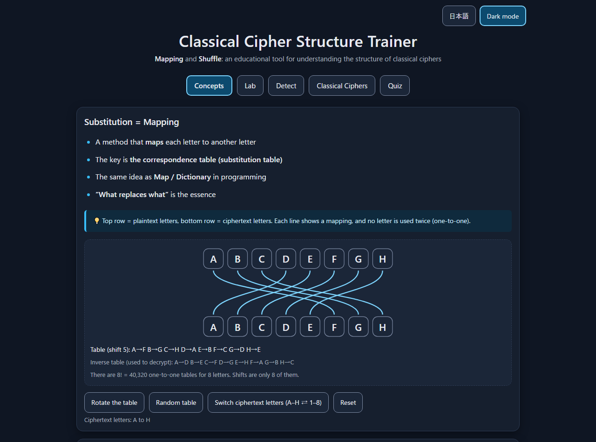

English · [日本語](README.md)

# Classical Cipher Structure Trainer - Educational Tool for Understanding Classical Cipher Structures


[](https://ipusiron.github.io/classical-cipher-structure-trainer/)

**Day097 - 100 Security Tools with Generative AI**

**Classical Cipher Structure Trainer** is an educational tool for learning the two building blocks of classical cryptography, substitution and transposition, through the intuitive ideas of mapping (a correspondence table) and shuffle (reordering).

You experience the two mechanisms with a mapping diagram and reorderable letter blocks, and in the Lab you apply ciphers to English text and count what is preserved and what is broken. The tool tells transposition, simple substitution and polyalphabetic ciphers apart from a ciphertext alone, and a quiz with explanations checks your understanding. Cards for 42 classical cipher tools of the series let you try each cipher. The screen can be switched between Japanese and English.

---

## 🌐 Demo

👉 **[https://ipusiron.github.io/classical-cipher-structure-trainer/](https://ipusiron.github.io/classical-cipher-structure-trainer/)**

You can try it directly in your browser.

---

## 📸 Screenshots

>
>
>*Concepts tab. Top: the shift-5 table (A→F). Bottom: EDUCATION after one pair swap*

>
>
>*Lab tab. A columnar transposition keeps the count of each letter and breaks the repetition pattern*

>
>
>*Detect tab. Judged polyalphabetic from the chi-squared and IC, with tools that accept the ciphertext*

>
>
>*Classical Ciphers tab. The 42 cards can be filtered by substitution, transposition, product and more*

>
>
>*Quiz tab. Each answer is marked correct or incorrect by color, symbol and text, with an explanation*

>
>
>*Dark mode. It follows the OS setting and can also be switched with the button at the top right*

---

## 🎯 Purpose and audience

### Intended users

- High school students (beginning cryptography in information classes, or wanting to grasp the mechanism without formulas)
- Security beginners (learning the basics of cryptography, or unsure about the jargon)
- Programmers and developers (relating ciphers to Map/Dictionary lookups and array shuffling)
- Information security engineers (reviewing the structure of classical ciphers, or looking for training material)
- Teachers and instructors (looking for supplementary material for cryptography lessons)
- Anyone interested in cryptography (Sherlock Holmes or historical ciphers)

### Purpose

- Organize the many classical ciphers by structure (substitution, transposition, and their combinations).
- Grasp the shared view of “key = table (mapping)” and “key = way of reordering (shuffle)”.
- Understand that both a substitution table and a transposition key are permutations (substitution permutes the kinds of letters, transposition permutes their positions), as a stepping stone to the “combination of substitution and permutation” in modern ciphers.

---

## 🧠 Tabs

### 1️⃣ Concepts

Learn the two building blocks, substitution and transposition, with diagrams and hands-on operations.

#### Substitution = Mapping

- A method that maps each letter to another letter.
- The key is the correspondence table (substitution table).
- The same idea as Map/Dictionary in programming: the essence is “what replaces what”.

The A–H table is drawn as an SVG diagram of lines connecting the top row (plaintext) with the bottom row (ciphertext), and the table is also shown as text below the diagram. The diagram is drawn in viewBox coordinates, so the 8 letters stay on one row even on a 320px-wide screen. The buttons do the following.

- “Rotate the table”: increases the shift by one (there are 8 shifts).
- “Random table”: picks a table uniformly at random (one of 8! = 40,320). Random numbers come from `crypto.getRandomValues`.
- “Switch ciphertext letters”: switches the bottom row between A–H and 1–8. The table itself stays the same.
- “Reset”: returns to shift 5 (A→F).

#### Transposition = Shuffle

- A method that changes the order of the letters.
- The key is the way of reordering (a permutation).

Drag the letter blocks of EDUCATION to reorder them. Mouse, touch and pen are handled together with Pointer Events, and a block lands where you release it even when the blocks wrap onto two or three rows on a narrow screen. With a keyboard, select a block, press Space to pick it up, move it with the arrow keys, Home or End, and press Space to drop it (Escape cancels). Each move is announced to screen readers. The buttons do the following.

- “Random order”: picks an arrangement uniformly at random (one of 9! = 362,880).
- “Reverse” and “Swap pairs”: apply to the current order. Both restore the original when applied twice (EDUCATION → DECUTAOIN → EDUCATION).
- “Reset”: returns to EDUCATION.

Below the diagram and the blocks, the keys themselves are shown: for the table, the inverse table (used to decrypt) and the number of tables; for the blocks, the key (which original letter is placed at position i), the key that restores the order, and the number of arrangements. The key of the pair swap (2 1 4 3 6 5 8 7 9) restores itself.

#### Terminology tip

If the terms “substitution” and “transposition” feel abstract, think of them as “mapping” and “shuffle”. Most classical ciphers can be organized as these two operations and their combinations (product ciphers).

The word “permutation” fits both. In his 1949 paper, Shannon wrote that the key of a simple substitution “is a permutation of the alphabet” and that the key of a transposition “can be represented by a permutation of the first d integers” (Bell System Technical Journal 28, pp.665–666). Both keys are permutations; think of substitution as permuting the kinds of letters and transposition as permuting their positions, and the difference becomes clear.

---

### 2️⃣ Lab

Apply ciphers to English text and count what is preserved and what is broken. Only the letters A to Z are used; other characters are removed (input up to 5,000 characters).

- Ciphers: simple substitution (shift, keyword alphabet, random alphabet), polyalphabetic (Vigenère cipher), transposition (reverse, rail fence, columnar transposition)
- Compared properties: count of each letter, counts sorted in descending order, pattern of repeated letters, index of coincidence (IC), chi-squared against English
- Charts: bar charts of letter counts (plaintext and ciphertext on the same vertical scale) and a table with the same numbers
- Columnar transposition and rail fence give the same results as Columnar CipherLab (Day043) and RailFence CipherLab (Day034)

Results for the Lab's example text (the opening of “Pride and Prejudice”, 302 letters; plaintext IC 0.0643):

| Cipher | Count of each letter | Sorted counts | Repetition pattern | IC |
|------|------|------|------|------|
| Simple substitution (keyword ZEBRA) | changed | preserved | preserved | 0.0643 |
| Polyalphabetic (Vigenère LEMON) | changed | changed | changed | 0.0398 |
| Transposition (columnar ZEBRAS) | preserved | preserved | changed | 0.0643 |

In “Combine (product) and order”, a substitution and a transposition are applied in turn, and the results of the two orders are compared. A simple substitution and a transposition give the same ciphertext in either order (Shannon 1949, p.672). With a Vigenère cipher and a transposition, the result depends on the order.

---

### 3️⃣ Detect

From an English ciphertext alone, the tool tells whether it looks like a transposition, a simple substitution, or a polyalphabetic cipher. Each step of the decision is shown with the values used.

1. With fewer than 30 letters, no decision is made.
2. If the chi-squared against English is below 115, the letter frequencies match ordinary English: “transposition” (plain English text gives the same result).
3. Otherwise, an index of coincidence (IC) of 0.052 or more means strongly skewed frequencies: “simple substitution”; below that, the frequencies are flattened: “polyalphabetic or similar”.

The example buttons enter the opening of “A Tale of Two Cities” (217 letters) with a cipher applied.

| Example | Chi-squared | IC | Result |
|------|------|------|------|
| Transposition (columnar ZEBRAS) | 70.8 | 0.0789 | Transposition |
| Simple substitution (keyword ZEBRA) | 3666.6 | 0.0789 | Simple substitution |
| Polyalphabetic (Vigenère LEMON) | 616.8 | 0.0493 | Polyalphabetic or similar |

After the decision, tools to try next are listed. Tools that accept a ciphertext (Permutation CipherLab, Anagram Hunter, Frequency Analyzer, IC Learning Visualizer, AlphaLoom) open with the ciphertext passed in the URL's `#text=`. When the text exceeds a tool's limit (400 to 10,000 characters), only the page is opened.

The thresholds and the accuracy were determined as follows (`tools/eval-classify.js`).

- Thresholds: from English text of Project Gutenberg #1342 “Pride and Prejudice”, 3 cipher types × 300 samples of 100 letters were made, and the values with the highest average accuracy were chosen
- Accuracy: measured on text from another book (Project Gutenberg #98 “A Tale of Two Cities”), 3 cipher types × 300 samples per length
- Cipher types: transposition is a columnar transposition with a 5 to 9 letter keyword, simple substitution uses a random alphabet, and polyalphabetic is a Vigenère cipher with a 3 to 8 letter key

| Length | Transposition | Simple substitution | Polyalphabetic |
|------|------|------|------|
| 50 letters | 100% | 88.3% | 85.7% |
| 100 letters | 99.7% | 100% | 93.7% |
| 200 letters | 100% | 100% | 95.3% |
| 400 letters | 100% | 100% | 98.7% |

A Vigenère cipher with a short key keeps some skew and may be reported as a simple substitution. Other languages, ciphers made of digits or symbols, and polygraphic ciphers such as Playfair are outside this table.

---

### 4️⃣ Classical Ciphers

Links to the 42 classical cipher tools of “100 Security Tools with Generative AI”. Press anywhere on a card to open the tool in a new tab. The cards are grouped into substitution, transposition, product, others (concealment and codes), and tools for solving and learning, and can be filtered with radio buttons. Each card has a tag such as simple substitution, polyalphabetic or polygraphic.

| Kind | Cipher | Description | Tool |
|------|------|------|--------|
| Substitution (simple) | Caesar cipher | Shifts every letter by the same amount; the shift sets the table | [Caesar Cipher Wheel Tool](https://ipusiron.github.io/caesar-cipher-wheel/) (Day003) |
| Substitution (simple) | Japanese Caesar cipher | Shifts hiragana by the same amount in gojuon or iroha order | [Japanese Caesar Cipher](https://ipusiron.github.io/japanese-caesar-cipher/) (Day004) |
| Substitution (simple) | Affine cipher | Maps each letter number with the linear function ax + b | [Affine CipherLab](https://ipusiron.github.io/affine-cipherlab/) (Day049) |
| Substitution (simple) | Pigpen cipher | Replaces letters with symbols made of grid lines and dots | [Pigpen CipherLab](https://ipusiron.github.io/pigpen-cipherlab/) (Day032) |
| Substitution (simple) | Dancing Men | From a Sherlock Holmes story; replaces letters with stick figures | [DancingMen CipherLab](https://ipusiron.github.io/dancingmen-cipherlab/) (Day022) |
| Substitution (simple) | Polybius square | Replaces each letter with its row and column numbers in a square | [Polybius CipherLab](https://ipusiron.github.io/polybius-cipherlab/) (Day067) |
| Substitution (simple) | Uesugi cipher | Replaces the 48 iroha kana with row and column numbers of a table | [Uesugi Cipher Tool](https://ipusiron.github.io/uesugi-cipher/) (Day012) |
| Substitution (simple) | Shinobi iroha | Replaces hiragana with kanji-like characters built from radicals | [Shinobi Iroha Cipher](https://ipusiron.github.io/shinobi_iroha_cipher/) (Day014) |
| Substitution (simple) | Bacon cipher | Replaces each letter with five a/b symbols and hides them as two typefaces in a text | [Bacon CipherLab](https://ipusiron.github.io/bacon-cipherlab/) (Day055) |
| Substitution (simple) | Zigzag cipher | Replaces letters with column positions of a key and draws a line; different from the English “zigzag cipher” (rail fence) | [Zigzag CipherLab](https://ipusiron.github.io/zigzag-cipherlab/) (Day072) |
| Substitution (simple) | ROT13 | Shifts letters by 13; applying it twice restores the text | [ROT13 Encoder](https://ipusiron.github.io/rot13-encoder/) (Day005) |
| Substitution (simple) | ROT47 | Shifts the 94 printable ASCII characters, including digits and symbols, by 47 | [QuickROT47](https://ipusiron.github.io/quick-rot47/) (Day037) |
| Substitution (simple) | Emoji cipher | Replaces ciphertext characters with emoji; the frequency skew remains | [Crypto Emoji Translator](https://ipusiron.github.io/crypto-emoji-translator/) (Day076) |
| Substitution (simple) | Caesar obfuscation | Obfuscates JavaScript with a Caesar cipher and restores it when running | [Classic JS Obfuscator](https://ipusiron.github.io/classic-js-obfuscator/) (Day042) |
| Substitution (polyalphabetic) | Vigenère cipher | Uses a different shift table for each key letter in turn | [Vigenere Cipher Tool](https://ipusiron.github.io/vigenere-cipher-tool/) (Day017) |
| Substitution (polyalphabetic) | Beaufort cipher | Polyalphabetic cipher that subtracts the plaintext from the key; encryption and decryption are the same | [Beaufort CipherLab](https://ipusiron.github.io/beaufort-cipherlab/) (Day078) |
| Substitution (polyalphabetic) | Strip cipher | Lines up many alphabet strips and reads a row other than the plaintext row | [Strip CipherLab](https://ipusiron.github.io/strip-cipherlab/) (Day071) |
| Substitution (polyalphabetic) | One-time pad | XORs with a single-use key as long as the plaintext; the key never repeats | [OTP Animation](https://ipusiron.github.io/otp-animation/) (Day029) |
| Substitution (polygraphic) | Playfair cipher | Replaces each pair of letters with another pair using a 5×5 table | [Playfair CipherLab](https://ipusiron.github.io/playfair-cipherlab/) (Day027) |
| Substitution (polygraphic) | Porta digraphic cipher | Replaces each pair of letters with one cell (symbol) of a 1563 table | [Porta CipherLab](https://ipusiron.github.io/porta-cipherlab/) (Day080) |
| Substitution (polygraphic) | Hill cipher | Replaces n letters at once with n letters by matrix multiplication | [Hill CipherLab](https://ipusiron.github.io/hill-cipherlab/) (Day093) |
| Transposition | Scytale | Writes on a strip wound around a rod and reads it unwound | [Scytale Cipher Visualizer](https://ipusiron.github.io/scytale-cipher-visualizer/) (Day010) |
| Transposition | Permutation cipher | Reorders every block of letters with the same permutation | [Permutation CipherLab](https://ipusiron.github.io/permutation-cipherlab/) (Day095) |
| Transposition | Rail fence cipher | Writes letters in a zigzag and reads them row by row | [RailFence CipherLab](https://ipusiron.github.io/railfence-cipherlab/) (Day034) |
| Transposition | Columnar transposition | Writes in rows and reads the columns in key order | [Columnar CipherLab](https://ipusiron.github.io/columnar-cipherlab/) (Day043) |
| Transposition | Turning grille | Fills a table by writing through a perforated card while turning it | [Grille CipherLab](https://ipusiron.github.io/grille-cipherlab/) (Day024) |
| Transposition | Mirror cipher (reversal) | Reverses the order of letters (whole text, words, lines, and so on) and combines it with mirrored glyphs | [Mirror CipherLab](https://ipusiron.github.io/mirror-cipherlab/) (Day084) |
| Product | SPN (repeated substitution and permutation) | Repeats S-boxes (substitution) and a P-layer (transposition) with key mixing; the skeleton of modern block ciphers | [ToySPN Builder](https://ipusiron.github.io/toyspn-builder/) (Day094) |
| Other (concealment) | Concealment cipher | Hides the letters of a message at fixed positions in an ordinary text | [Hidden Message Challenge](https://ipusiron.github.io/hidden-message-challenge/) (Day036) |
| Other (concealment) | Trevanion cipher | Reads the third letter after each punctuation mark of a letter (a null cipher) | [Trevanion CipherLab](https://ipusiron.github.io/trevanion-cipherlab/) (Day069) |
| Other (concealment) | Chronogram | Adds up the letters that are Roman numerals in a sentence to express a year | [Epigraph Chronogrammer](https://ipusiron.github.io/epigraph-chronogrammer/) (Day086) |
| Other (code) | Book code | A code that represents words by their position in a book (page, line, word) | [Book Code Builder](https://ipusiron.github.io/book-code-builder/) (Day099) |
| Solve (analysis) | Cipher identification | Estimates which classical cipher was used from the features of a ciphertext | [Cipher Clairvoyance](https://ipusiron.github.io/cipher-clairvoyance/) (Day044) |
| Solve (analysis) | Frequency analysis | Solves simple substitutions by hand with English frequencies, the IC, and n-grams | [Frequency Analyzer](https://ipusiron.github.io/frequency-analyzer/) (Day009) |
| Solve (analysis) | Caesar brute force | Tries all 25 shifts and ranks candidates by English words and frequencies | [Caesar Cipher Breaker](https://ipusiron.github.io/caesar-cipher-breaker/) (Day008) |
| Solve (analysis) | Hill climbing | Changes the table little by little toward more English-like text | [Cipher Climb](https://ipusiron.github.io/cipherclimb/) (Day018) |
| Solve (analysis) | Index of coincidence | Tells simple from polyalphabetic ciphers by the IC and estimates key lengths with per-period IC | [IC Learning Visualizer](https://ipusiron.github.io/ic-learning-visualizer/) (Day047) |
| Solve (analysis) | Repeated sequences (Kasiski) | Estimates the key length of a polyalphabetic cipher from repeat distances and column ICs | [RepeatSeq Analyzer](https://ipusiron.github.io/repeatseq-analyzer/) (Day028) |
| Solve (analysis) | Splitting into columns | Splits a ciphertext into columns by period, turning a polyalphabetic cipher into simple substitutions | [Modular Text Divider](https://ipusiron.github.io/modular-text-divider/) (Day030) |
| Solve (analysis) | Key candidate search | Ranks key candidates of a polyalphabetic cipher by likely letters per position and dictionary words | [AlphaLoom](https://ipusiron.github.io/alphaloom/) (Day046) |
| Solve (analysis) | Anagram search | Finds words and phrases made by reordering letters; useful for solving transpositions by hand | [Anagram Hunter](https://ipusiron.github.io/anagram-hunter/) (Day045) |
| Learn | Operations that undo themselves | Learn with substitution, transposition and bit flips how applying an operation twice restores the input | [Involution Studio](https://ipusiron.github.io/involution-studio/) (Day051) |

- The zigzag cipher (Day072) replaces letters with column positions of a key, a kind of substitution. In English, “zigzag cipher” often means the rail fence cipher (a transposition), but it is a different cipher.
- The Hill cipher (Day093) and Porta's digraphic cipher (Day080) replace several letters at once: polygraphic substitution. This is a different distinction from polyalphabetic ciphers (such as Vigenère), which change the table by position.

---

### 5️⃣ Quiz

- Format: single-answer questions
- Questions: 20 (3 definition, 4 basics, 6 classification, 3 properties, 4 mixed)
- Data: `js/quiz-data.js` (loaded as a script, so it works even when `index.html` is opened directly from a file)
- After answering: correct and incorrect choices are marked by color, symbol (✓✗) and text, with an explanation
- Answer positions: spread over the four positions as 5, 5, 6 and 4 questions, so always picking the same position scores at most 30%
- Shuffle the questions and choices: when on, the question order and the choice order are uniform random permutations
- Result: score and percentage, a message in three levels, and a review of the questions you missed (your answer, the correct answer, the explanation)

Example questions:

- “Which method keeps the letters unchanged and only reorders them?” → Transposition
- “The World War I ADFGVX cipher replaces each letter with a pair of symbols from a table, then reorders them with a columnar transposition. How is it classified?” → Product (substitution + transposition)
- “An English ciphertext has letter counts almost the same as ordinary English. What is likely?” → Transposition

---

## 🎯 Use cases

### Ways of using this tool in particular

- Check whether a conversion can be undone: a conversion with a code table (Map) in a program has the same form as a substitution. If each top letter has exactly one line to the bottom row (one-to-one), an inverse table exists and the conversion can be undone. There are 8! = 40,320 one-to-one tables for A–H. It is practice for spotting rows that map two values to the same value in data migration or code reassignment reviews.
- Feel “operations that undo themselves”: reversing and pair swapping restore the original when applied twice (EDUCATION → DECUTAOIN → EDUCATION). It is an entry point to checking whether toggles and round-trip conversions (such as ROT13) restore the input with the same operation. Involution Studio (Day051) explores this property further.
- Show that the number of keys is not security: there are 8! = 40,320 tables for A–H and 26! = 403,291,461,126,605,635,584,000,000 (about 4.03×10^26) for 26 letters. Even so, a simple substitution is broken by letter frequencies. It introduces the point that the “number of combinations” alone does not measure password strength. Frequency Analyzer (Day009) shows the frequencies in practice.
- Design puzzles: decide first whether the cipher changes the letters (substitution) or the order (transposition), and the hint to give solvers (a table or an arrangement) follows. The 9 letters of EDUCATION have 9! = 362,880 arrangements, but a meaningful word can be solved as an anagram. The clue of a transposition is the remaining letters, not the number of arrangements.
- Think about what survives pseudonymization and reordering: pseudonymization that replaces values with symbols through a table has the same form as a simple substitution, so the same value becomes the same symbol (HELLO with the keyword ZEBRA becomes FAJJM, and the LL repetition survives as JJ). Reordering rows only has the same form as a transposition, so the count of each value survives. The “What is preserved” table in the Lab is an entry point to thinking about what anonymization methods can leak (it does not judge the safety of personal data).
- Check whether processing steps can be swapped: a simple substitution and a columnar transposition give the same result in either order. With a Vigenère cipher instead, the Lab's example text differs from letter 1. It is a hands-on way to ask whether the order of preprocessing steps (such as normalization and sorting) can be swapped.

### Education and self-study

- In the cryptography unit of information classes, sort the cipher names in the textbook into substitution, transposition and product.
- At the start of a lesson, project the Concepts tab and press “Rotate the table” to show that the Caesar cipher is a table made only of shifts. Then press “Random table” to show a simple substitution table.
- Read the quiz explanations and check why the missed classification questions are classified as they are.

### Work and programming

- Before using a crypto library, understand the two operations of replacement (substitution) and reordering (transposition). In an AES round, SubBytes replaces bytes and ShiftRows reorders byte positions. ToySPN Builder (Day094) lets you experience the structure that combines and repeats the two.
- In onboarding training, introduce conversions with Map and Dictionary and array shuffling as the two types of ciphers.

### Hobbies and creative work

- When making ciphers for puzzle events or escape games, decide first between substitution and transposition, then make the ciphertext with the tools in the Classical Ciphers tab.

### Combining with other tools

- Estimate the cipher of a ciphertext: Cipher Clairvoyance (Day044). It handles more methods (such as autokey and Playfair) than the Detect tab
- Count letter frequencies: Frequency Analyzer (Day009); learn the index of coincidence (IC): IC Learning Visualizer (Day047)
- Handle a transposition key as a permutation: Permutation CipherLab (Day095)

### Limitations

- This tool is learning material. The Lab applies ciphers to English text and compares counts, but it has no decryption or key management. Use the tools in the Classical Ciphers tab for actual encryption and solving.
- The Detect tab is an estimate limited to three types applied to English text (transposition, simple substitution, polyalphabetic). It does not determine the cipher.
- It does not guarantee the security of classical ciphers. Classical ciphers cannot protect communications today.

---

## 🔍 How to tell substitution from transposition in a ciphertext

The basics of telling them apart when only the ciphertext is available, without the plaintext.

### Three points of view

#### 1️⃣ The kinds of characters

- A transposition uses the plaintext letters as they are, so only the same kinds of characters as the plaintext appear.
- If symbols, digits or unfamiliar characters appear, a substitution is likely.
- However, a substitution that replaces letters with letters (such as the Caesar cipher) cannot be told apart by appearance.

#### 2️⃣ Letter counts (frequencies)

- A transposition keeps the letter frequencies. In English, E, T, A, O, I, N and so on stay frequent in the ciphertext (Shannon 1949, p.694 “With a transposition cipher it is clear that letter frequencies are preserved”).
- A simple substitution keeps the counts sorted in descending order, but the frequent letters are other letters than E and T.
- A polyalphabetic cipher (such as Vigenère) changes the table by position, which flattens the frequencies. The index of coincidence (IC) measures this difference.

#### 3️⃣ The pattern of repeated letters

- In a simple substitution, the same plaintext letter becomes the same ciphertext letter, so the repetition pattern within words is kept (HELLO and KHOOR both repeat the 3rd and 4th letters).
- In a transposition, the positions change, so this pattern is not kept.

### Decision flow

```
Look at the ciphertext
    ↓
Q1: Do symbols, digits or characters not used in the plaintext appear?
    YES → substitution is likely
    NO  → go to Q2
    ↓
Q2: Are the letter counts close to ordinary text (E, T, A frequent in English)?
    YES → transposition is likely (try rearranging into meaningful words)
    NO  → go to Q3
    ↓
Q3: Are the frequencies strongly skewed (clearly frequent letters)?
    YES → simple substitution is likely
    NO  → possibly polyalphabetic, with a table that changes by position
```

Frequencies are unstable in short ciphertexts, so every decision is only a likelihood. A product of substitution and transposition keeps the counts sorted in descending order just like a simple substitution, so frequencies alone cannot tell it from a simple substitution.

### Examples

| Plaintext | Ciphertext | Kind | Reason |
|------|--------|------|------|
| `HELLO` | `KHOOR` | Substitution | A table shifted by 3. The LL of HELLO becomes OO in KHOOR, keeping the repetition pattern |
| `HELLO` | `OLLEH` | Transposition | The same letters, only reversed |
| `HELLO` | `●■▲▲◆` | Substitution | Replaced with symbols. Only L becomes the same symbol ▲ |
| `ATTACK` | `KCATTA` | Transposition | The same kinds and counts of letters (an anagram), reversed |

### Tools for telling them apart

The Detect tab of this tool decides by the frequencies (chi-squared) from 2️⃣ and the index of coincidence. For detailed estimates and solving, use these tools.

- [Frequency Analyzer - Frequency analysis tool](https://ipusiron.github.io/frequency-analyzer/)
- [Cipher Clairvoyance - Cipher identification tool](https://ipusiron.github.io/cipher-clairvoyance/)
- [IC Learning Visualizer - Index of coincidence learning tool](https://ipusiron.github.io/ic-learning-visualizer/)

---

## 🧮 Educational points

- Organize the many classical ciphers by their structure.
- With the two views of mapping and shuffle, picture what the key is (a table or a way of reordering).
- A simple substitution and a transposition give the same result in either order (Shannon 1949, p.672 “multiplication is not in general commutative …, although in special cases, such as substitution and transposition, it is”). Combining the two still keeps the counts sorted in descending order.
- Shannon wrote that good mixing transformations are often made by repeating two simple operations whose order matters (p.712 “Good mixing transformations are often formed by repeated products of two simple non-commuting operations”). Modern block ciphers repeat substitution and permutation many times with key mixing in between.

---

## 🔬 Technical information

- HTML/CSS/JavaScript (fully client-side; no libraries, no CDN, no external communication)
- The cores `js/structure-core.js` (tables and permutations) and `js/lab-core.js` (Lab and Detect) are pure functions that do not depend on the page; the Node.js tests load the same code
- English frequencies are in `js/english-freq.js` (A–Z counts of Gutenberg #1342); the Detect accuracy is in `js/classify-accuracy.js`, written by `tools/eval-classify.js`
- The mapping diagram is SVG (drawn in viewBox coordinates, without measuring the page)
- Reordering uses Pointer Events (mouse, touch, pen) and the keyboard. The insertion point is decided by the row (wrapping) first and then the column
- Random numbers come from `crypto.getRandomValues`. Uniform integers that redraw the remainder of 2^32 and Fisher–Yates produce unbiased permutations
- WAI-ARIA tabs (arrow keys, Home, End), announcements with aria-live, buttons at least 44px tall
- Japanese/English switching (button at the top right). The initial language is chosen by `?lang=ja` or `?lang=en`, the saved choice, then the browser language. index.html is written in Japanese; `js/i18n.js` records the Japanese strings right after loading and replaces them with the table in `js/i18n-en.js`
- Light/dark colors (OS setting and a toggle button). Tests check 4.5:1 for text and 3:1 for borders and focus
- MIT License

### 🔧 Technical documentation for developers

See [TECHNICAL.md](TECHNICAL.md) (Japanese) for implementation details and [SECURITY.md](SECURITY.md) (Japanese) for security measures.

---

## 🔒 Security

- A Content Security Policy in a meta element limits scripts, styles and images to the same origin and forbids network connections (connect-src) and form targets.
- All text is inserted with `textContent`; there is no assignment to `innerHTML`.
- External links open with `rel="noopener noreferrer"`, and no referrer is sent (no-referrer).
- When passing a ciphertext to another tool, it goes into the URL's `#text=`. The part after `#` is not sent to the server, but it remains in the browser history.
- Only the color and language choices are stored (localStorage), and the tool works where storage is unavailable.
- GitHub Pages cannot set response headers, so there is no clickjacking protection (frame-ancestors). frame-ancestors in a meta element is ignored by the specification.

---

## 🧪 Tests

```bash
npm test
```

- Runs on Node.js 22 or later with no dependencies (`node --test`).
- GitHub Actions runs it automatically on every push and pull request.
- The tests check the cores (tables, permutations, uniform randomness, insertion points), the Lab calculations (known answers, preserved properties, swapping the order, the Detect thresholds), the quiz data, the list of classical cipher tools, the CSP and ARIA of index.html, the color contrast ratios, the message dictionaries and the Japanese/English correspondence (no Japanese left in the English messages, quiz and catalog), file formatting, and the examples and numbers in the README. The README tables and numbers are recomputed from the cores by the tests.

---

## 📁 Directory structure

```
classical-cipher-structure-trainer/
├── index.html                # Page (Concepts, Lab, Detect, Classical Ciphers, Quiz)
├── script.js                 # Page logic (diagram, reordering, Lab, Detect, cards, quiz)
├── style.css                 # Styles (light/dark colors, responsive layout)
├── js/                       # Scripts loaded by the page
│   ├── structure-core.js     # Core (tables, permutations, randomness, insertion point, quiz checks)
│   ├── messages.js           # Japanese and English messages built by script.js
│   ├── quiz-data.js          # 20 quiz questions with explanations (Japanese and English)
│   ├── catalog.js            # List of the 42 tools in the Classical Ciphers tab
│   ├── lab-core.js           # Lab core (substitution, transposition, polyalphabetic, statistics, detection)
│   ├── english-freq.js       # English letter counts (the basis of detection)
│   ├── classify-accuracy.js  # Detection accuracy (output of tools/eval-classify.js)
│   ├── i18n.js               # Japanese/English switching (records and replaces the Japanese text of index.html)
│   ├── i18n-en.js            # English table for index.html
│   └── theme.js              # Initial color theme and toggle (loaded before drawing)
├── data/                     # Assets
│   ├── favicon.svg           # Favicon
│   └── diagram-mapping.svg   # Static sample of the mapping diagram (not used by the page)
├── assets/                   # README images
│   ├── screenshot.png        # Concepts tab (Japanese)
│   ├── screenshot2.png       # Lab tab (Japanese)
│   ├── screenshot3.png       # Detect tab (Japanese)
│   ├── screenshot4.png       # Classical Ciphers tab (Japanese)
│   ├── screenshot5.png       # Quiz tab (Japanese)
│   ├── screenshot6.png       # Dark mode (Japanese)
│   └── en/                   # English screenshots for README.en.md (the same six)
│       ├── screenshot.png    # Concepts tab
│       ├── screenshot2.png   # Lab tab
│       ├── screenshot3.png   # Detect tab
│       ├── screenshot4.png   # Classical Ciphers tab
│       ├── screenshot5.png   # Quiz tab
│       └── screenshot6.png   # Dark mode
├── test/                     # node:test tests
│   ├── core.test.js          # Core
│   ├── quiz.test.js          # Quiz data
│   ├── catalog.test.js       # List of classical cipher tools
│   ├── lab.test.js           # Lab core and detection thresholds
│   ├── html.test.js          # index.html (CSP, ARIA, loaded scripts)
│   ├── contrast.test.js      # Color contrast ratios
│   ├── messages.test.js      # Message dictionaries
│   ├── i18n.test.js          # Japanese/English switching and English messages, quiz, catalog
│   ├── format.test.js        # File formatting
│   └── readme.test.js        # README examples, numbers and structure
├── tools/                    # Helper scripts
│   └── eval-classify.js      # Chooses the detection thresholds and measures accuracy (writes js/classify-accuracy.js)
├── .github/                  # GitHub settings
│   └── workflows/            # GitHub Actions
│       └── test.yml          # npm test on push and pull request
├── package.json              # npm test definition (no dependencies)
├── README.md                 # README (Japanese)
├── README.en.md              # This document
├── TECHNICAL.md              # Implementation notes (Japanese)
├── SECURITY.md               # Security measures (Japanese)
├── CLAUDE.md                 # Guide for Claude Code
├── LICENSE                   # MIT License
├── .gitignore                # Git ignore rules
└── .nojekyll                 # Disables Jekyll on GitHub Pages
```

---

## 💻 Requirements

- Browsers: checked with Playwright's Chromium (the same engine as Chrome and Edge) and Firefox. Safari, Edge and real smartphones have not been checked.
- Everything works even when `index.html` is opened directly from a file (the quiz questions are also loaded as a script).
- To use a local server, run `python -m http.server 8000` in the repository folder and open `http://localhost:8000/`.

---

## 📄 License

MIT License – see [LICENSE](LICENSE) for details.

---

## 🛠️ About this tool

This tool was developed as part of the "100 Security Tools with Generative AI" project.
In this project, a variety of security-related tools are built and released over 100 days with the help of AI.

For details on the project and other tools, see the following page.

🔗 [https://akademeia.info/?page_id=42163](https://akademeia.info/?page_id=42163)
