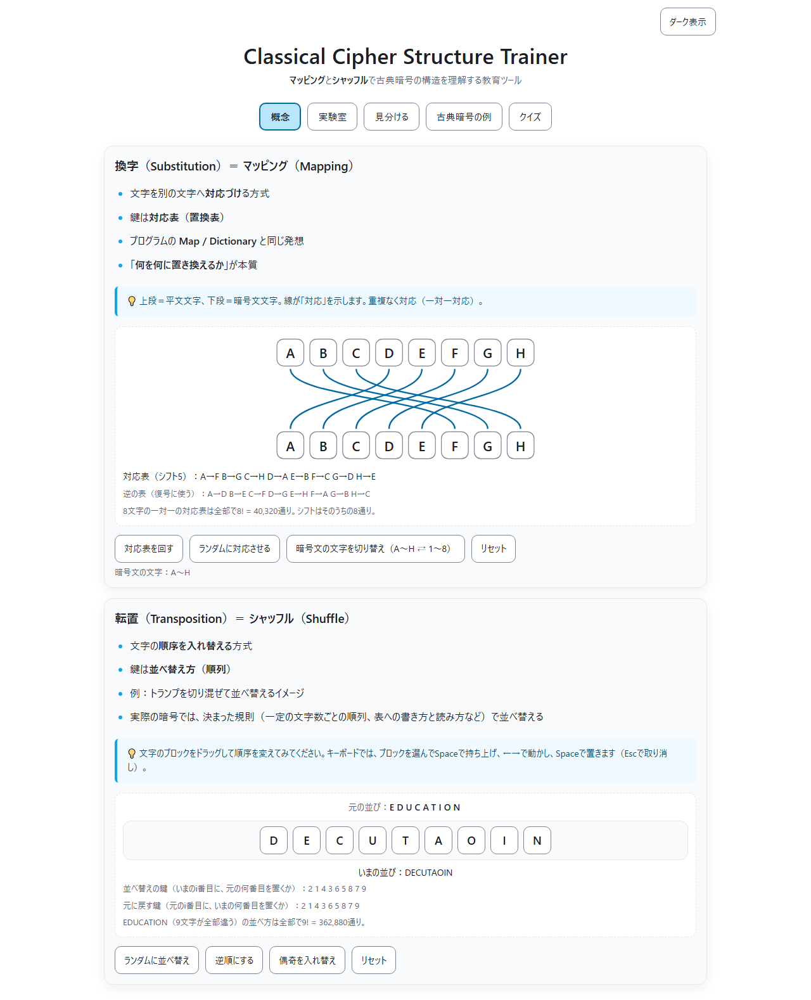

<!--
---
id: day097
slug: classical-cipher-structure-trainer

title: "Classical Cipher Structure Trainer"

subtitle_ja: "古典暗号の構造理解の教育ツール"
subtitle_en: "Educational Tool for Understanding Classical Cipher Structures"

description_ja: "古典暗号の2大構造「換字（Substitution）」と「転置（Transposition）」を、マッピングとシャッフルという直感的な概念でインタラクティブに学べる教育ツール。SVG曲線による対応関係の可視化、ドラッグ＆ドロップによる並べ替え体験、10問のクイズで理解を確認。"
description_en: "An interactive educational tool that teaches the two fundamental structures of classical cryptography—Substitution (mapping) and Transposition (shuffle)—through intuitive visualizations. Features SVG curve mapping, drag-and-drop shuffle experience, and a 10-question quiz."

category_ja:
  - 古典暗号
  - 換字式暗号
  - 転置式暗号
category_en:
  - Classical Cryptography
  - Substitution Cipher
  - Transposition Cipher

difficulty: 3

tags:
  - classical-cipher
  - substitution
  - transposition
  - education
  - visualization
  - interactive
  - quiz
  - javascript

repo_url: "https://github.com/ipusiron/classical-cipher-structure-trainer"
demo_url: "https://ipusiron.github.io/classical-cipher-structure-trainer/"

hub: true
---
-->

# Classical Cipher Structure Trainer - 古典暗号の構造理解の教育ツール


[](https://ipusiron.github.io/classical-cipher-structure-trainer/)

**Day097 - 生成AIで作るセキュリティツール100**

**Classical Cipher Structure Trainer** は、古典暗号を構成する2大要素**「換字（Substitution）」と「転置（Transposition）」** を、**マッピング（対応表）と シャッフル（並べ替え）** という直感的概念で学べる教育ツールです。

古典暗号の仕組みを図解と体験的UIで理解し、最後にクイズで確認します。  

すでに作成済みの暗号ツール群（Caesar, Vigenère, Hillなど）へのリンクから、個別の実装や応用を学ぶことができます。

---

## 🌐 デモページ

👉 **[https://ipusiron.github.io/classical-cipher-structure-trainer/](https://ipusiron.github.io/classical-cipher-structure-trainer/)**

ブラウザーで直接お試しいただけます。

---

## 📸 スクリーンショット

>
>*ツールを通じて「換字」と「転置」を理解する*

---

## 🎯 目的と対象

### 対象ユーザー

- **高校生**
  - 情報科目で暗号を学び始めた方
  - 数学的な難しさを避けて直感的に理解したい方
- **セキュリティ入門者**
  - 暗号の基礎を学びたい方
  - 専門用語に不安がある方
- **プログラマー・開発者**
  - Map/Dictionaryなどのデータ構造と関連づけて理解したい方
  - 暗号化ライブラリを使う前に基礎を押さえたい方
- **情報セキュリティエンジニア**
  - 古典暗号の構造を復習したい方
  - 教育・研修資料として活用したい方
- **教員・講師**
  - 暗号教育の補助教材を探している方
  - 視覚的でわかりやすい教材が必要な方
- **暗号技術に興味がある一般の方**
  - 趣味で暗号を学びたい方
  - シャーロックホームズや歴史上の暗号に関心がある方

### 目的

- 古典暗号の複雑な分類を「構造（換字・転置）」で整理する
- 「鍵＝対応表（Mapping）」または「鍵＝並べ替え方（Shuffle）」という共通概念をつかむ
- 仕組みを可視化し、後の暗号理解（現代暗号を含む）への足掛かりとする  

---

## 🧠 タブ構成

### 1️⃣ 概念（Introduction）

古典暗号の2大要素「換字」と「転置」を、インタラクティブな図解と体験型UIで学べます。

#### 換字（Substitution）＝ 置換 ＝ マッピング（Mapping）

- 文字を別の文字へ**対応づけ**る方式
- 鍵は**対応表（置換表）**
- プログラムの Map / Dictionary と同じ発想で、**「何を何に置き換えるか」**が本質
- **インタラクティブ機能：**
  - A-H の対応図をSVG線で可視化
  - 「対応表を回す」ボタン：規則的なシフト対応
  - 「ランダムに対応させる」ボタン：ランダムな換字を生成
  - 「リセット」ボタン：初期状態に戻す

#### 転置（Transposition）＝ シャッフル（Shuffle）

- 文字の**順序を入れ替える**方式
- 鍵は**並べ替え方（順列）**
- イメージ：トランプをぐちゃぐちゃにして並べ替える
- **インタラクティブ機能：**
  - EDUCATION の文字ブロックをドラッグ＆ドロップで並べ替え
  - 「ランダム並べ替え」ボタン：Fisher-Yatesシャッフル
  - 「逆順に並べ替え」ボタン：完全逆順（NOITACUDE）
  - 「偶奇入れ替え」ボタン：隣接ペアを交換（繰り返し可能）
  - 「リセット」ボタン：元の順序に戻す

> 💡 **用語のヒント**
> 「換字」「転置」の漢字がイメージしにくい・忘れやすい場合は、
> **「マッピング（Mapping）」と「シャッフル（Shuffle）」** に脳内で置き換えることをおすすめします。
> この2つの概念で古典暗号のほぼすべてを理解できます。

---

### 2️⃣ 古典暗号の例（Examples）

外部の学習ツールへのリンク集。カード形式で22種類の古典暗号を紹介しています。

| 種別 | 暗号名 | 説明 | リンク |
|------|---------|------|--------|
| 換字 | シーザー暗号・シフト暗号 | もっとも基本的な換字方式であり、置換表は文字をずらしたもの。 | 🔗 [Caesar Cipher Wheel Tool](https://ipusiron.github.io/caesar-cipher-wheel/) |
| 換字 | 日本語版シーザー暗号 | 日本語版のシフト暗号。 | 🔗 [Japanese Caesar Cipher](https://ipusiron.github.io/japanese-caesar-cipher/) |
| 換字 | ピッグペン暗号 | 図形・記号による視覚的な換字式暗号。 | 🔗 [Pigpen CipherLab](https://ipusiron.github.io/pigpen-cipherlab/) |
| 換字 | 踊る人形暗号 | 「シャーロックホームズ」に登場する暗号。人形風の文字を使うのが特徴的な換字式暗号。 | 🔗 [DancingMen CipherLab](https://ipusiron.github.io/dancingmen-cipherlab/) |
| 換字 | ポリュビオス暗号 | 文字を数字ペアに変換する暗号。ポリュビオスのチェッカー盤が置換表そのもの。 | 🔗 [Polybius CipherLab](https://ipusiron.github.io/polybius-cipherlab/) |
| 換字 | 上杉暗号 | いろは文字を座標位置を示す文字群に変換する暗号。 | 🔗 [Uesugi Cipher Tool](https://ipusiron.github.io/uesugi-cipher/) |
| 換字 | 忍びいろはの暗号 | いろは文字を漢字風の文字に変換する暗号。 | 🔗 [Shinobi Iroha Cipher Tool](https://ipusiron.github.io/shinobi_iroha_cipher/) |
| 換字 | プレイフェア暗号 | 2文字を別の文字に変換する換字式暗号。 | 🔗 [Playfair CipherLab](https://ipusiron.github.io/playfair-cipherlab/) |
| 換字 | ポルタ暗号 | 2文字を記号に変換する換字式暗号。 | 🔗 [Porta CipherLab](https://ipusiron.github.io/porta-cipherlab/) |
| 換字 | ベーコン暗号 | アルファベット1文字を2進5文字列に対応づける暗号。 | 🔗 [Bacon CipherLab](https://ipusiron.github.io/bacon-cipherlab/) |
| 換字 | ストリップ暗号 | 複数のストリップを用いた、シンプルな多表式暗号。 | 🔗 [Bacon CipherLab](https://github.com/ipusiron/strip-cipherlab) |
| 換字 | ヴィジュネル暗号 | 鍵で可変マッピングする多表式暗号。 | 🔗 [Vigenere Cipher Tool](https://ipusiron.github.io/vigenere-cipher-tool/) |
| 換字 | ビューフォート暗号 | 鍵で可変マッピングする多表式暗号の別バージョン。 | 🔗 [Beaufort CipherLab](https://ipusiron.github.io/beaufort-cipherlab/) |
| 換字 | アフィン暗号 | 1文字ずつ一次関数で置き換える暗号。 | 🔗 [Affine CipherLab](https://ipusiron.github.io/affine-cipherlab/) |
| 換字 | ヒル暗号 | 線形代数の行列演算を用いて、平文の文字を別の文字に置き換える。ブロック単位で複数文字を同時変換するのが特徴的。多表式のアフィン暗号に相当。 | 🔗 [Hill CipherLab](https://ipusiron.github.io/hill-cipherlab/) |
| 転置 | スキュタレー暗号 | 平文を記した布・紙を棒に巻きつけ、棒の方向に沿って読む暗号。  | 🔗 [Scytale Cipher Visualizer](https://ipusiron.github.io/scytale-cipher-visualizer/) |
| 転置 | 転置式暗号 | 並べ替え順序が鍵となる転置式。 | 🔗 [Permutation CipherLab](https://ipusiron.github.io/permutation-cipherlab/) |
| 転置 | ジグザグ暗号 | 波形に並べることで順序を変える。 | 🔗 [Zigzag CipherLab](https://ipusiron.github.io/zigzag-cipherlab/) |
| 転置 | レールフェンス暗号 | 複数のレールに順番に書き込んだ後に、横に読む暗号。 | 🔗 [RailFence CipherLab](https://ipusiron.github.io/railfence-cipherlab/) |
| 転置 | 縦列転置式暗号 | マトリクスに横に並べてから順序を変えてから縦に読む。 | 🔗 [Columnar CipherLab](https://ipusiron.github.io/columnar-cipherlab/) |
| 転置 | 回転グリル暗号 | 穴空きの台紙から平文を書き入れ、台紙を回転していくことでマトリクスを埋めていく暗号。 | 🔗 [Grille CipherLab](https://ipusiron.github.io/grille-cipherlab/) |
| その他 | 分置式暗号 | ダミーメッセージ内に本当のメッセージを隠す。 | 🔗 [Hidden Message Challenge](hhttps://ipusiron.github.io/hidden-message-challenge/) |

---

### 3️⃣ クイズ（Quiz）

- 問題形式：**一問一答形式**（単一選択）
- 問題数：10問（定義2・基礎2・分類4・混合理解2）
- ソース：`data/quiz.json`
- **即時フィードバック：** 1問ごとに正解・不正解を表示し、解説を確認できます
- 最終結果：正答率＋メッセージ表示（3段階）

例題：
- 「文字を別の文字に対応させる方式は？」 → 換字（Substitution）
- 「文字の並びだけを入れ替える方式は？」 → 転置（Transposition）
- 「ヴィジュネル暗号はどちら？」 → 換字（Substitution）

---

## 💡 活用シナリオ

### シナリオ1：高校生の情報授業での予習・復習

**状況：** 高校の情報科目で「暗号」の単元が始まったAさん。教科書には「シーザー暗号」「転置式暗号」など様々な名前が出てくるが、違いがよく分からない。

**活用方法：**
1. **概念タブ**で「換字」と「転置」の2つの構造を視覚的に理解
2. マッピング図の「ランダムに対応させる」ボタンを何度も押して、ランダムな換字の様子を体感
3. シャッフル図で「EDUCATION」をドラッグ＆ドロップして転置を実際に体験
4. **古典暗号の例タブ**で教科書に出てきた暗号名をクリックし、外部ツールで実際の暗号処理を体験
5. **クイズタブ**で理解度をチェック。間違えた問題は解説を読んで復習

**効果：** 「換字＝マッピング」「転置＝シャッフル」という2つの概念で整理でき、授業内容がスッキリ理解できた。

---

### シナリオ2：Webエンジニアが暗号化ライブラリを使う前の基礎学習

**状況：** Web開発者のBさん。プロジェクトで暗号化機能を実装することになり、AES暗号やRSA暗号のライブラリを使う予定だが、「そもそも暗号とは何か」を理解していないまま使うのは不安。

**活用方法：**
1. **概念タブ**で「暗号＝文字の対応づけ（Map）または並べ替え（Shuffle）」という本質を理解
2. 開発で使う Dictionary や Array のシャッフルと結びつけて、暗号の仕組みをプログラマー視点で納得
3. **古典暗号の例タブ**から「ヒル暗号」「アフィン暗号」など数学的な暗号にも触れ、現代暗号への橋渡しを実感
4. 「マッピング」「シャッフル」という用語のヒントを活用し、専門用語に抵抗感がなくなる

**効果：** 現代暗号（AES/RSA）のドキュメントを読む際に、「この処理は置換（Substitution）の発展形だな」「これはブロック単位の並べ替えか」と理解が深まり、安心してライブラリを使えるようになった。

---

### シナリオ3：情報セキュリティ講師が授業の補助教材として活用

**状況：** 専門学校で情報セキュリティを教えるC先生。暗号の授業で学生が「シーザー暗号」「ヴィジュネル暗号」などの違いを混乱している様子。

**活用方法：**
1. 授業の冒頭で本ツールの**概念タブ**をプロジェクターで投影
2. 「対応表を回す」ボタンを押しながら「これがシーザー暗号の本質です」と実演
3. 「ランダムに対応させる」ボタンで「単一換字暗号はこういうランダムな対応表を使います」と説明
4. 学生に各自のPCで**古典暗号の例タブ**から興味のある暗号を選んで体験させる
5. 授業の最後に**クイズタブ**を使って理解度確認。正答率が低い問題は次回授業で重点的に解説

**効果：** 学生から「図解があって分かりやすかった」「マッピングとシャッフルの2つだけ覚えれば良いと分かってスッキリした」との声。授業後のアンケートでも高評価。

---

## 🔍 暗号文から換字式か転置式かをどう識別するか

暗号文を見て、それが換字式か転置式かを判別する際の重要なポイントを紹介します。

### 🔍 判別の3つの観点

#### 1️⃣ 文字の種類（文字集合）をチェック

**換字式の特徴：**
- 文字が**別の文字や記号に変換**される
- 元の文字とは異なる見た目になることが多い
- 例：`HELLO` → `KHOOR`（シーザー暗号）、`HELLO` → `⌐∟⌐⌐⌐`（ピッグペン暗号）

**転置式の特徴：**
- 文字は**そのまま**で順序だけが変わる
- 使われている文字の種類は平文と同じ
- 例：`HELLO` → `OLLEH`（逆順）、`HELLO` → `LOLEH`（並べ替え）

💡 **識別ポイント：** 暗号文に見慣れない記号や文字があれば換字式の可能性が高い！

---

#### 2️⃣ 文字の出現頻度を比較

**換字式の特徴：**
- 各文字の**出現回数は変わらない**（単純換字の場合）
- 例：`HELLO`（Lが2回）→ `KHOOR`（Oが2回）
- 頻度分析が暗号解読の手がかりになる

**転置式の特徴：**
- 文字の**出現回数は完全に保持**される
- 例：`HELLO`（H:1, E:1, L:2, O:1）→ `OLLEH`（H:1, E:1, L:2, O:1）
- 平文と暗号文で文字の種類と個数が完全一致

💡 **識別ポイント：** 平文と暗号文が「アナグラム」（同じ文字の並べ替え）なら転置式！

---

#### 3️⃣ 暗号文の「読みやすさ」を観察

**換字式の特徴：**
- 文字が変換されるため、**見慣れない組み合わせ**が多い
- 母音・子音のバランスが崩れることがある
- 例：`KHOOR`（子音が連続）

**転置式の特徴：**
- 元の文字がそのまま使われるため、**部分的に読める**ことがある
- 文字の組み合わせに自然さが残る
- 例：`OLLEH`（OLやEHは英語的に不自然だが、文字自体は自然）

💡 **識別ポイント：** 転置式は「元の単語の痕跡」が残りやすい！

---

### 📊 判別フローチャート

```
暗号文を見る
    ↓
Q1: 元の文字と違う文字・記号が使われている？
    YES → 換字式の可能性大
    NO  → 次へ
    ↓
Q2: 平文と暗号文で文字の種類と個数が完全一致？
    YES → 転置式の可能性大
    NO  → 換字式の可能性大
    ↓
Q3: 暗号文を並べ替えると意味のある言葉になる？
    YES → 転置式確定
    NO  → 換字式または混合式
```

---

### 🧪 実例で確認

| 平文 | 暗号文 | 種別 | 理由 |
|------|--------|------|------|
| `HELLO` | `KHOOR` | 換字 | 文字が変換されている（H→K, E→H, L→O, O→R） |
| `HELLO` | `OLLEH` | 転置 | 同じ文字が使われ、順序だけ変化 |
| `HELLO` | `●■●●◆` | 換字 | 記号に置換されている |
| `ATTACK` | `KCATTA` | 転置 | アナグラム（文字の種類と個数が同じ） |

---

### ツールで識別する

- [Frequency Analyzer - 頻度分析ツール](https://ipusiron.github.io/frequency-analyzer/)
- [Cipher Clairvoyance - 暗号化方式推定ツール](https://ipusiron.github.io/cipher-clairvoyance/)

---

## 🧮 教育的ポイント

- 古典暗号の多様な方式を「構造」で整理できる  
- **Mapping と Shuffle** という抽象化で理解が一気に進む  
- 現代暗号のような高度な数式やアルゴリズムを学ぶ前に、  
  「鍵とは何か」「構造とは何か」を明確にイメージできる  

---

## ⚙️ 技術情報

- HTML / CSS / JavaScript（クライアントサイド完結）
- 白背景・図解中心の教材デザイン
- クイズデータ：JSON外部読み込み（`data/quiz.json`）
- SVG Bézier曲線による対応関係の可視化
- Fisher-Yatesシャッフルアルゴリズム
- HTML5 Drag and Drop API + タッチイベント対応
- Content Security Policy（CSP）によるセキュリティ対策
- ARIA属性によるアクセシビリティ対応
- MIT License

### 🔧 開発者向け技術ドキュメント

実装の詳細、コアロジック、アルゴリズムの解説は以下をご覧ください：

👉 **[TECHNICAL.md - 技術詳細ドキュメント](TECHNICAL.md)**

- SVG Bézier曲線による対応関係の可視化
- Fisher-Yatesシャッフルアルゴリズム
- ドラッグ&ドロップの実装（マウス/タッチ/キーボード対応）
- 偶奇入れ替えの繰り返し可能な実装
- セキュリティ対策（CSP、DOM操作、JSON検証）
- レスポンシブデザインとアクセシビリティ
- パフォーマンス最適化

---

## 🧩 ディレクトリー構成

```
classical-cipher-structure-trainer/
│
├── index.html              # メインHTML（3タブ構成：概念、古典暗号の例、クイズ）
├── script.js               # JavaScriptロジック（マッピング/シャッフル、クイズ機能）
├── style.css               # スタイルシート（レスポンシブデザイン）
│
├── data/                   # データファイル
│   ├── quiz.json          # クイズ問題データ（10問）
│   ├── favicon.svg        # ファビコン
│   └── diagram-mapping.svg # マッピング図（参考用）
│
├── assets/                 # アセットファイル
│   └── screenshot.png     # スクリーンショット画像
│
├── README.md               # プロジェクト説明（本ファイル）
├── TECHNICAL.md            # 開発者向け技術詳細ドキュメント
├── LICENSE                 # MITライセンス
├── CLAUDE.md               # Claude Code用ガイド
├── SECURITY.md             # セキュリティ関連ドキュメント
├── .gitignore              # Git除外設定
└── .nojekyll               # GitHub Pages設定
```

---

## 📄 ライセンス

MIT License – 詳細は [LICENSE](LICENSE) を参照してください。

---

## 🛠️ このツールについて

本ツールは、「生成AIで作るセキュリティツール100」プロジェクトの一環として開発されました。
このプロジェクトでは、AIの支援を活用しながら、セキュリティに関連するさまざまなツールを100日間にわたり制作・公開していく取り組みを行っています。

プロジェクトの詳細や他のツールについては、以下のページをご覧ください。

🔗 [https://akademeia.info/?page_id=42163](https://akademeia.info/?page_id=42163)
