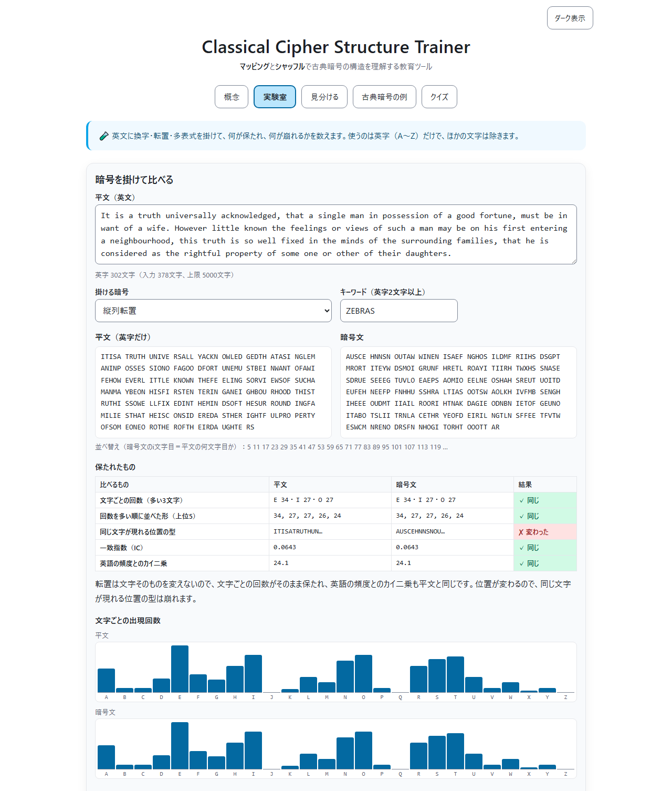
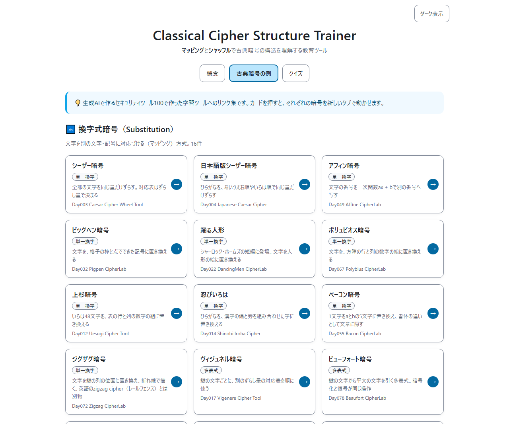
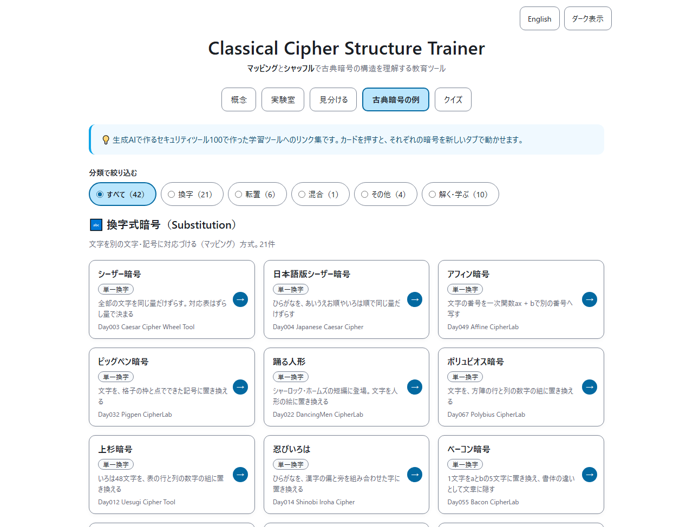

<!--
---
id: day097
slug: classical-cipher-structure-trainer

title: "Classical Cipher Structure Trainer"

subtitle_ja: "古典暗号の構造理解の教育ツール"
subtitle_en: "Educational Tool for Understanding Classical Cipher Structures"

description_ja: "古典暗号の2大構造「換字（Substitution）」と「転置（Transposition）」を、マッピングとシャッフルという直感的な概念で学べる教育ツール。対応表のSVG図、マウス・タッチ・キーボードで動かす並べ替え、シリーズの古典暗号ツール42本への案内、解説つきの10問クイズで、換字は文字の種類を、転置は文字の位置を並べ替える仕組みだと理解できる。"
description_en: "An educational tool that teaches the two fundamental structures of classical cryptography, Substitution (mapping) and Transposition (shuffle). It offers an SVG mapping diagram, a block reordering exercise that works with mouse, touch and keyboard, a guide to 22 classical cipher tools in the series, and a 10-question quiz with explanations, showing that substitution permutes the kinds of letters while transposition permutes their positions."

category_ja:
  - 古典暗号
  - 換字式暗号
  - 転置式暗号
category_en:
  - Classical Cryptography
  - Substitution Cipher
  - Transposition Cipher

difficulty: 3

tags:
  - classical-cipher
  - substitution
  - transposition
  - education
  - visualization
  - interactive
  - quiz
  - javascript

repo_url: "https://github.com/ipusiron/classical-cipher-structure-trainer"
demo_url: "https://ipusiron.github.io/classical-cipher-structure-trainer/"

hub: true
---
-->

# Classical Cipher Structure Trainer - 古典暗号の構造理解の教育ツール


[](https://ipusiron.github.io/classical-cipher-structure-trainer/)

**Day097 - 生成AIで作るセキュリティツール100**

**Classical Cipher Structure Trainer**は、古典暗号を構成する2大要素「換字（Substitution）」と「転置（Transposition）」を、マッピング（対応表）とシャッフル（並べ替え）という直感的な概念で学べる教育ツールです。

対応表の図と、文字のブロックの並べ替えで2つの仕組みを体験し、最後に解説つきのクイズで確かめます。シリーズで作った古典暗号のツール42本へのカードから、個々の暗号を実際に動かせます。

---

## 🌐 デモページ

👉 **[https://ipusiron.github.io/classical-cipher-structure-trainer/](https://ipusiron.github.io/classical-cipher-structure-trainer/)**

ブラウザーで直接お試しいただけます。

---

## 📸 スクリーンショット

>
>
>*概念タブ。上はシフト5の対応表（A→F）の図、下はEDUCATIONに偶奇入れ替えを1回掛けた並び*

>
>
>*クイズタブ。答えると正解・不正解を色と印と文字で示し、解説を表示する*

>
>
>*古典暗号の例タブ。分類のタグ（単一換字・多表式など）つきのカード*

>
>
>*ダーク表示。OSの設定に従い、右上のボタンでも切り替えられる*

---

## 🎯 目的と対象

### 対象ユーザー

- 高校生（情報科目で暗号を学び始めた人、数式を使わずに仕組みをつかみたい人）
- セキュリティ入門者（暗号の基礎を学びたい人、専門用語に不安がある人）
- プログラマー・開発者（Map／Dictionaryや配列の並べ替えと結びつけて理解したい人）
- 情報セキュリティエンジニア（古典暗号の構造を復習したい人、研修資料を探している人）
- 教員・講師（暗号の授業の補助教材を探している人）
- 暗号に興味がある一般の人（シャーロック・ホームズや歴史上の暗号に関心がある人）

### 目的

- 古典暗号のさまざまな方式を「構造（換字・転置、その組み合わせ）」で整理する。
- 「鍵＝対応表（マッピング）」「鍵＝並べ替え方（シャッフル）」という共通の見方をつかむ。
- 換字の対応表も転置の並べ替えも順列である（換字は文字の種類を、転置は文字の位置を並べ替える）と理解し、現代暗号の「置き換えと並べ替えの組み合わせ」への足がかりにする。

---

## 🧠 タブ構成

### 1️⃣ 概念（Introduction）

古典暗号の2大要素「換字」と「転置」を、図と操作で学びます。

#### 換字（Substitution）＝ マッピング（Mapping）

- 文字を別の文字へ対応づける方式である。
- 鍵は対応表（置換表）である。
- プログラムのMap／Dictionaryと同じ発想で、「何を何に置き換えるか」が本質である。

A〜Hの対応表を、上段（平文）と下段（暗号文）を結ぶ線のSVG図で表示し、図の下に対応表を文字でも示します。図はviewBoxの座標で描くので、幅320pxの画面でも8文字が1行に並びます。ボタンでできることは次のとおりです。

- 「対応表を回す」：シフト量を1つずつ増やす（シフトは8通り）。
- 「ランダムに対応させる」：一様に選んだ対応表（8! = 40,320通りのどれか）にする。乱数は`crypto.getRandomValues`で作る。
- 「暗号文の文字を切り替え」：下段をA〜Hと1〜8で切り替える。対応表はそのままである。
- 「リセット」：シフト5（A→F）に戻す。

#### 転置（Transposition）＝ シャッフル（Shuffle）

- 文字の順序を入れ替える方式である。
- 鍵は並べ替え方（順列）である。

EDUCATIONの文字のブロックを、ドラッグで並べ替えます。マウス・タッチ・ペンはPointer Eventsで共通に扱い、狭い画面で2段・3段に折り返しても、指を離した位置に入ります。キーボードでは、ブロックを選んでSpaceで持ち上げ、←→・Home・Endで動かし、Spaceで置きます（Escで取り消し）。動かした結果は読み上げにも伝えます。ボタンでできることは次のとおりです。

- 「ランダムに並べ替え」：一様に選んだ並べ方（9! = 362,880通りのどれか）にする。
- 「逆順にする」「偶奇を入れ替え」：いまの並びに掛ける。どちらも2回で元に戻る（EDUCATION → DECUTAOIN → EDUCATION）。
- 「リセット」：EDUCATIONに戻す。

#### 用語のヒント

「換字」「転置」の漢字がイメージしにくいときは、「マッピング」と「シャッフル」に置き換えて考えるとわかりやすくなります。古典暗号の多くは、この2つと、その組み合わせ（混合）で整理できます。

「置換」という語は、換字（文字の置き換え）にも、数学の置換（並べ替え＝順列）にも使われます。Shannonは1949年の論文で、単一換字の鍵を「アルファベットの置換（a permutation of the alphabet）」、転置の鍵を「最初のd個の整数の置換」と書いています（Bell System Technical Journal 28, p.665〜666）。どちらの鍵も順列で、換字は文字の種類を、転置は文字の位置を並べ替えると考えると、2つの違いがはっきりします。

---

### 2️⃣ 古典暗号の例（Examples）

生成AIで作るセキュリティツール100の古典暗号のツール42本へのリンク集です。カード全体を押すと、新しいタブで開きます。カードには、換字式の中の分け方（単一換字・多表式・多字換字）のタグを付けています。

| 種別 | 暗号 | 説明 | ツール |
|------|------|------|--------|
| 換字（単一換字） | シーザー暗号 | 全部の文字を同じ量だけずらす。対応表はずらし量で決まる | [Caesar Cipher Wheel Tool](https://ipusiron.github.io/caesar-cipher-wheel/)（Day003） |
| 換字（単一換字） | 日本語版シーザー暗号 | ひらがなを、あいうえお順やいろは順で同じ量だけずらす | [Japanese Caesar Cipher](https://ipusiron.github.io/japanese-caesar-cipher/)（Day004） |
| 換字（単一換字） | アフィン暗号 | 文字の番号を一次関数ax + bで別の番号へ写す | [Affine CipherLab](https://ipusiron.github.io/affine-cipherlab/)（Day049） |
| 換字（単一換字） | ピッグペン暗号 | 文字を、格子の枠と点でできた記号に置き換える | [Pigpen CipherLab](https://ipusiron.github.io/pigpen-cipherlab/)（Day032） |
| 換字（単一換字） | 踊る人形 | シャーロック・ホームズの短編に登場。文字を人形の絵に置き換える | [DancingMen CipherLab](https://ipusiron.github.io/dancingmen-cipherlab/)（Day022） |
| 換字（単一換字） | ポリュビオス暗号 | 文字を、方陣の行と列の数字の組に置き換える | [Polybius CipherLab](https://ipusiron.github.io/polybius-cipherlab/)（Day067） |
| 換字（単一換字） | 上杉暗号 | いろは48文字を、表の行と列の数字の組に置き換える | [Uesugi Cipher Tool](https://ipusiron.github.io/uesugi-cipher/)（Day012） |
| 換字（単一換字） | 忍びいろは | ひらがなを、漢字の偏と旁を組み合わせた字に置き換える | [Shinobi Iroha Cipher](https://ipusiron.github.io/shinobi_iroha_cipher/)（Day014） |
| 換字（単一換字） | ベーコン暗号 | 1文字をaとbの5文字に置き換え、書体の違いとして文章に隠す | [Bacon CipherLab](https://ipusiron.github.io/bacon-cipherlab/)（Day055） |
| 換字（単一換字） | ジグザグ暗号 | 文字を鍵の列の位置に置き換え、折れ線で描く。英語のzigzag cipher（レールフェンス）とは別物 | [Zigzag CipherLab](https://ipusiron.github.io/zigzag-cipherlab/)（Day072） |
| 換字（単一換字） | ROT13 | 英字を13文字ずらす。同じ操作を2回掛けると元に戻る | [ROT13 Encoder](https://ipusiron.github.io/rot13-encoder/)（Day005） |
| 換字（単一換字） | ROT47 | ASCIIの記号・数字を含む94文字を、47文字ずらす | [QuickROT47](https://ipusiron.github.io/quick-rot47/)（Day037） |
| 換字（単一換字） | 絵文字の暗号 | 暗号文の文字を絵文字に置き換える。見た目が変わっても頻度の偏りは残る | [Crypto Emoji Translator](https://ipusiron.github.io/crypto-emoji-translator/)（Day076） |
| 換字（単一換字） | シーザー暗号による難読化 | JavaScriptのコードをシーザー暗号で置き換え、実行するときに戻して動かす | [Classic JS Obfuscator](https://ipusiron.github.io/classic-js-obfuscator/)（Day042） |
| 換字（多表式） | ヴィジュネル暗号 | 鍵の文字ごとに、別のずらし量の対応表を順に使う | [Vigenere Cipher Tool](https://ipusiron.github.io/vigenere-cipher-tool/)（Day017） |
| 換字（多表式） | ビューフォート暗号 | 鍵の文字から平文の文字を引く多表式。暗号化と復号が同じ操作 | [Beaufort CipherLab](https://ipusiron.github.io/beaufort-cipherlab/)（Day078） |
| 換字（多表式） | ストリップ暗号 | アルファベットを並べた帯を何本も並べ、平文の行とは別の行を読む | [Strip CipherLab](https://ipusiron.github.io/strip-cipherlab/)（Day071） |
| 換字（多表式） | ワンタイムパッド | 平文と同じ長さの使い捨ての鍵とXORする。鍵を繰り返さない | [OTP Animation](https://ipusiron.github.io/otp-animation/)（Day029） |
| 換字（多字換字） | プレイフェア暗号 | 5×5の表で、2文字を別の2文字に置き換える | [Playfair CipherLab](https://ipusiron.github.io/playfair-cipherlab/)（Day027） |
| 換字（多字換字） | ポルタの二文字式暗号 | 1563年の表で、2文字を表の1マス（記号）に置き換える | [Porta CipherLab](https://ipusiron.github.io/porta-cipherlab/)（Day080） |
| 換字（多字換字） | ヒル暗号 | 行列の掛け算で、n文字をまとめて別のn文字に置き換える | [Hill CipherLab](https://ipusiron.github.io/hill-cipherlab/)（Day093） |
| 転置 | スキュタレー暗号 | 帯を棒に巻いて書き、ほどいて読む | [Scytale Cipher Visualizer](https://ipusiron.github.io/scytale-cipher-visualizer/)（Day010） |
| 転置 | 転置式暗号（順列） | 一定の文字数ごとに、同じ順列で並べ替える | [Permutation CipherLab](https://ipusiron.github.io/permutation-cipherlab/)（Day095） |
| 転置 | レールフェンス暗号 | 文字をジグザグに書き、行ごとに読む | [RailFence CipherLab](https://ipusiron.github.io/railfence-cipherlab/)（Day034） |
| 転置 | 縦列転置式暗号 | 表に横に書き、鍵の順に列を縦に読む | [Columnar CipherLab](https://ipusiron.github.io/columnar-cipherlab/)（Day043） |
| 転置 | 回転グリル暗号 | 穴のあいた型紙を回しながら書き込み、表を埋める | [Grille CipherLab](https://ipusiron.github.io/grille-cipherlab/)（Day024） |
| 転置 | ミラー暗号（逆転置） | 文字の並びを逆にする（全文・語・行など）。字形の鏡像と組み合わせる | [Mirror CipherLab](https://ipusiron.github.io/mirror-cipherlab/)（Day084） |
| 混合 | SPN（換字と転置の繰り返し） | S-Box（換字）とP層（転置）に鍵の加算を挟んで繰り返す。現代のブロック暗号の骨組み | [ToySPN Builder](https://ipusiron.github.io/toyspn-builder/)（Day094） |
| その他（分置式） | 分置式暗号 | ふつうの文章の中に、本文の文字を決まった位置に散らして隠す | [Hidden Message Challenge](https://ipusiron.github.io/hidden-message-challenge/)（Day036） |
| その他（分置式） | トレヴァニオン暗号 | 手紙の句読点の直後から数えて3文字目を拾い集めて読む（Null暗号） | [Trevanion CipherLab](https://ipusiron.github.io/trevanion-cipherlab/)（Day069） |
| その他（分置式） | クロノグラム | 文の中のローマ数字に当たる文字を足して、年号を表す | [Epigraph Chronogrammer](https://ipusiron.github.io/epigraph-chronogrammer/)（Day086） |
| その他（コード） | 書籍暗号（ブックコード） | 語を、本の中の位置（ページ・行・語の番号）で表すコード | [Book Code Builder](https://ipusiron.github.io/book-code-builder/)（Day099） |
| 解く（解析・解読） | 暗号方式の推定 | 暗号文の特徴から、どの古典暗号が使われたかを推定する | [Cipher Clairvoyance](https://ipusiron.github.io/cipher-clairvoyance/)（Day044） |
| 解く（解析・解読） | 頻度分析 | 英語の頻度・一致指数・n-gramで、単一換字を手で解く | [Frequency Analyzer](https://ipusiron.github.io/frequency-analyzer/)（Day009） |
| 解く（解析・解読） | シーザー暗号の総当たり | 25通りのずらし量をすべて試し、英単語と頻度で候補を選ぶ | [Caesar Cipher Breaker](https://ipusiron.github.io/caesar-cipher-breaker/)（Day008） |
| 解く（解析・解読） | 山登り法による解読 | 換字表を少しずつ変え、英語らしさが上がる方へ進めて解く | [Cipher Climb](https://ipusiron.github.io/cipherclimb/)（Day018） |
| 解く（解析・解読） | 一致指数（IC） | ICで単一換字と多表式を見分け、周期ごとのICで鍵の長さを推定する | [IC Learning Visualizer](https://ipusiron.github.io/ic-learning-visualizer/)（Day047） |
| 解く（解析・解読） | 繰り返しの解析（カシスキー） | 暗号文の繰り返しの間隔と列のICから、多表式の鍵の長さを推定する | [RepeatSeq Analyzer](https://ipusiron.github.io/repeatseq-analyzer/)（Day028） |
| 解く（解析・解読） | 列への分割 | 暗号文を周期ごとの列に分け、多表式を単一換字の集まりにして解く | [Modular Text Divider](https://ipusiron.github.io/modular-text-divider/)（Day030） |
| 解く（解析・解読） | 鍵の候補の探索 | 鍵の位置ごとに来そうな文字を並べ、辞書の語で多表式の鍵の候補を採点する | [AlphaLoom](https://ipusiron.github.io/alphaloom/)（Day046） |
| 解く（解析・解読） | アナグラムの探索 | 文字を並べ替えて作れる語やフレーズを探す。転置を手で解くときに使える | [Anagram Hunter](https://ipusiron.github.io/anagram-hunter/)（Day045） |
| 学ぶ | 2回で元に戻る操作 | 換字・転置・ビット反転で、同じ操作を2回掛けると元に戻る性質を学ぶ | [Involution Studio](https://ipusiron.github.io/involution-studio/)（Day051） |

- ジグザグ暗号（Day072）は、文字を鍵の列の位置に置き換える換字の一種である。英語でzigzag cipherというとレールフェンス暗号（転置）の別名を指すことが多いが、別の暗号である。
- ヒル暗号（Day093）とポルタの二文字式暗号（Day080）は、複数の文字をまとめて置き換える多字換字である。位置ごとに別の対応表を使う多表式（ヴィジュネル暗号など）とは別の分け方である。

---

### 3️⃣ クイズ（Quiz）

- 問題形式：一問一答形式（単一選択）
- 問題数：10問（定義2・基礎2・分類4・混合2）
- 問題データ：`js/quiz-data.js`（スクリプトとして読むので、`index.html`をファイルから直接開いても動く）
- 回答後の表示：正解・不正解を色と印（✓✗）と文字で示し、解説を出す
- 分類の4問：選択肢がそろっており、単一換字・多表式・転置・混合がそれぞれ1回ずつ正解になる
- 最終結果：正解数と正答率、3段階のメッセージ

例題：

- 「文字そのものは変えずに、並び順だけを入れ替える方式はどれ？」→ 転置（Transposition）
- 「第一次世界大戦のADFGVX暗号は、表で文字を2文字の組に置き換えたあと、縦列転置で並べ替える。どれに分類される？」→ 混合（換字＋転置）
- 「英文の暗号文の文字の出現回数が、普通の英語とほぼ同じだった。考えられるのは？」→ 転置

---

## 🎯 ユースケース

### このツールならではの使い方

- 変換の処理が元に戻せるかを確かめる：プログラムのコード表（Map）による変換は、換字と同じ形をしている。対応図の線が上段と下段で1本ずつになっている（一対一）なら逆の表が作れ、戻せる。A〜Hの一対一の対応表は8! = 40,320通りある。データの移行やコードの付け替えの設計レビューで、重複して同じ値へ写る行がないかを見る練習になる。
- 「2回で元に戻る操作」を体感する：逆順と偶奇入れ替えは、同じ操作を2回かけると元に戻る（EDUCATION → DECUTAOIN → EDUCATION）。トグルの機能や往復の変換（ROT13など）を設計するとき、同じ操作で元に戻るかを確かめる考え方の入口になる。Involution Studio（Day051）で、この性質をさらに調べられる。
- 鍵の数と安全性が別の話だと示す：A〜Hの対応表は8! = 40,320通り、26文字なら26! = 403,291,461,126,605,635,584,000,000通り（約4.03×10^26）ある。それでも単一換字は文字の頻度で破れる。パスワードの「組み合わせの数」だけで強さを語らない、という話の導入に使える。頻度の実際はFrequency Analyzer（Day009）で確かめられる。
- 謎解きの問題を設計する：作る暗号が「文字が変わる（換字）」のか「並びが変わる（転置）」のかを先に決めると、解き手に渡すヒント（対応表か、並べ方か）が決まる。EDUCATIONの9文字の並べ方は9! = 362,880通りあるが、意味のある単語ならアナグラムとして解ける。転置の手がかりは並べ方の数ではなく、残った文字にある。

### 教育・自習

- 情報科目の「暗号」の単元の予習・復習で、教科書に出てくる暗号の名前を、換字・転置・混合のどれかに振り分ける。
- 授業の冒頭で概念タブを投影し、「対応表を回す」を押しながらシーザー暗号はシフトだけの対応表だと示す。続けて「ランダムに対応させる」で単一換字の対応表を見せる。
- クイズの解説を読み、間違えた問題の分類の理由を確かめる。

### 仕事・プログラミング

- 暗号ライブラリーを使う前に、置き換え（換字）と並べ替え（転置）の2つの操作を押さえる。AESのラウンドでも、SubBytesはバイトの置き換え、ShiftRowsはバイトの位置の並べ替えである。2つを組み合わせて繰り返す構造は、ToySPN Builder（Day094）で体験できる。
- 新人研修で、MapとDictionaryによる変換と、配列のシャッフルを、暗号の2つの型として紹介する。

### 趣味・創作

- 謎解きイベントや脱出ゲームの暗号を作るとき、まず換字か転置かを決め、古典暗号の例タブのツールで実際の暗号文を作る。

### ほかのツールとの組み合わせ

- 暗号文の方式を推定する：Cipher Clairvoyance（Day044）
- 文字の頻度を数える：Frequency Analyzer（Day009）、一致指数（IC）を学ぶ：IC Learning Visualizer（Day047）
- 転置の鍵を順列として扱う：Permutation CipherLab（Day095）

### 限界

- 本ツールは仕組みを学ぶ教材であり、任意の文を暗号化・復号する道具ではない（対応表はA〜Hの8文字、並べ替えはEDUCATIONの9文字）。実際の暗号化と解読は、古典暗号の例タブのツールで行う。
- 古典暗号の安全性を保証するものではない。古典暗号は、いまの通信の秘密を守る用途には使えない。

---

## 🔍 暗号文から換字式か転置式かをどう見分けるか

平文が手元にない、暗号文だけの場面での見分け方の基本を紹介します。

### 見分けの3つの観点

#### 1️⃣ 出てくる文字の種類

- 転置は平文の文字をそのまま使うので、平文と同じ種類の文字しか出てこない。
- 記号・数字・見慣れない字が出てくるなら、換字の可能性が高い。
- ただし、換字でも英字を英字に置き換えるもの（シーザー暗号など）は、見た目では区別できない。

#### 2️⃣ 文字の出現回数（頻度）

- 転置は文字の頻度をそのまま保つ。英文なら、暗号文でもE・T・A・O・I・Nなどが多いままになる（Shannon 1949, p.694 "With a transposition cipher it is clear that letter frequencies are preserved"）。
- 単一換字は、回数を多い順に並べた形は平文と同じだが、多い文字がE・Tではなく別の文字になる。
- 多表式（ヴィジュネル暗号など）は、位置ごとに対応表が変わるので頻度がならされる。この違いは一致指数（IC）で測れる。

#### 3️⃣ 同じ文字が現れる位置の型

- 単一換字では、同じ平文の文字は同じ暗号文の文字になるので、語の中の繰り返しの型が保たれる（HELLOとKHOORは、どちらも3文字目と4文字目が同じ）。
- 転置では文字の位置が変わるので、この型は保たれない。

### 判別の流れ

```
暗号文を見る
    ↓
Q1: 平文に使われない記号・数字・字が出てくる？
    YES → 換字の可能性が高い
    NO  → Q2へ
    ↓
Q2: 文字の出現回数が、普通の文（英語ならE・T・Aが多い）とほぼ同じ？
    YES → 転置の可能性が高い（意味のある語に並べ替えられるかを試す）
    NO  → Q3へ
    ↓
Q3: 頻度が大きく偏っている（多い文字がはっきりある）？
    YES → 単一換字の可能性が高い
    NO  → 多表式など、位置ごとに対応表が変わる方式の可能性
```

短い暗号文では頻度が安定しないので、どの判定も「可能性」にとどまります。換字と転置を重ねた混合の暗号は、単一換字と同じく「多い順の形」が残るので、頻度だけでは単一換字と区別できません。

### 実例で確認

| 平文 | 暗号文 | 種別 | 理由 |
|------|--------|------|------|
| `HELLO` | `KHOOR` | 換字 | 3文字ずらしの対応表。HELLOのLLがKHOORのOOになり、繰り返しの型が残る |
| `HELLO` | `OLLEH` | 転置 | 同じ文字のまま、順序だけ逆にした |
| `HELLO` | `●■▲▲◆` | 換字 | 記号に置き換えた。Lだけが同じ記号▲になる |
| `ATTACK` | `KCATTA` | 転置 | 文字の種類と個数が同じ（アナグラム）。逆順にした |

### ツールで見分ける

- [Frequency Analyzer - 頻度分析ツール](https://ipusiron.github.io/frequency-analyzer/)
- [Cipher Clairvoyance - 暗号化方式推定ツール](https://ipusiron.github.io/cipher-clairvoyance/)
- [IC Learning Visualizer - 一致指数の学習ツール](https://ipusiron.github.io/ic-learning-visualizer/)

---

## 🧮 教育的ポイント

- 古典暗号のさまざまな方式を「構造」で整理できる。
- マッピングとシャッフルという2つの見方で、鍵が何なのか（対応表か、並べ替え方か）をイメージできる。
- 単一換字と転置は、どちらを先に掛けても結果が同じになる（Shannon 1949, p.672 "multiplication is not in general commutative …, although in special cases, such as substitution and transposition, it is"）。この2つを重ねても、回数を多い順に並べた形は残る。
- Shannonは、よく混ぜる変換は「入れ替えると結果が変わる2つの簡単な操作」の繰り返しで作られることが多いと書いている（p.712 "Good mixing transformations are often formed by repeated products of two simple non-commuting operations"）。現代のブロック暗号は、置き換えと並べ替えに鍵の加算などを挟み、何度も繰り返す。

---

## 🔬 技術情報

- HTML／CSS／JavaScript（クライアントサイドで完結。ライブラリー・CDN・外部への通信なし）
- 計算部`js/structure-core.js`は画面に依存しない純粋関数で、Node.jsのテストから同じコードを読む
- 対応図はSVG（viewBoxの座標で描き、画面の寸法を測らない）
- 並べ替えはPointer Events（マウス・タッチ・ペン）とキーボード操作。差し込み位置は行（折り返し）を先に決めてから列を比べる
- 乱数は`crypto.getRandomValues`。2^32を割り切れない端を引き直す一様な整数とFisher–Yatesで、偏りのない順列を作る
- WAI-ARIAのタブ（←→・Home・End）、aria-liveでの読み上げ、ボタンの高さ44px以上
- ライト／ダークの配色（OSの設定と切り替えボタン）。文字4.5:1、枠とフォーカス3:1以上をテストで検査する
- MIT License

### 🔧 開発者向け技術ドキュメント

実装の詳細は[TECHNICAL.md](TECHNICAL.md)を、セキュリティ対策は[SECURITY.md](SECURITY.md)をご覧ください。

---

## 🔒 セキュリティ

- meta要素のContent Security Policyで、スクリプト・スタイル・画像を同じオリジンに限り、通信（connect-src）とフォームの送信先を禁止している。
- 画面の文字はすべて`textContent`で入れ、`innerHTML`への代入はない。
- 外部へのリンクは`rel="noopener noreferrer"`で開き、referrerは送らない（no-referrer）。
- 保存するのは配色の選択（localStorage）だけで、使えない環境でも動く。
- GitHub Pagesでは応答ヘッダーを設定できないので、クリックジャッキング対策（frame-ancestors）は入れていない。meta要素のframe-ancestorsは仕様上無視される。

---

## 🧪 テスト

```bash
npm test
```

- Node.js 22以上で動き、依存パッケージはない（`node --test`）。
- GitHub Actionsで、pushとpull requestのたびに自動で実行する。
- 計算部（対応表・順列・乱数の一様さ・差し込み位置）、クイズのデータ、古典暗号の例の一覧、index.htmlのCSPとARIA、配色のコントラスト比、文言の辞書、ファイルの書式、READMEの例と数値を検査する。READMEの表と数値は、テストが計算部から計算し直して一致を確かめる。

---

## 📁 ディレクトリー構造

```
classical-cipher-structure-trainer/
├── index.html                # 画面（概念・古典暗号の例・クイズの3タブ）
├── script.js                 # 画面の動き（対応図・並べ替え・タブ・クイズ・カードの描画）
├── style.css                 # 見た目（ライト／ダークの配色、レスポンシブ）
├── js/                       # 画面から読むスクリプト
│   ├── structure-core.js     # 計算部（対応表・順列・乱数・差し込み位置・クイズの検査）
│   ├── messages.js           # script.jsが組み立てる文言の辞書
│   ├── quiz-data.js          # クイズの10問（解説つき）
│   ├── catalog.js            # 古典暗号の例のツール42本の一覧
│   ├── lab-core.js           # 実験室の計算部（換字・転置・多表式・統計・見分け）
│   ├── english-freq.js       # 英語の文字の出現回数（見分けの基準）
│   ├── classify-accuracy.js  # 見分けの当たり具合（tools/eval-classify.jsの出力）
│   └── theme.js              # 配色の初期値と切り替え（描画の前に読む）
├── data/                     # 素材
│   ├── favicon.svg           # ファビコン
│   └── diagram-mapping.svg   # 対応図の静的な見本（画面では使わない）
├── assets/                   # READMEの画像
│   ├── screenshot.png        # 概念タブ
│   ├── screenshot2.png       # クイズタブ（解説の表示）
│   ├── screenshot3.png       # 古典暗号の例タブ
│   └── screenshot4.png       # ダーク表示
├── test/                     # node:testのテスト
│   ├── core.test.js          # 計算部
│   ├── quiz.test.js          # クイズのデータ
│   ├── catalog.test.js       # 古典暗号の例の一覧
│   ├── lab.test.js           # 実験室の計算部と見分けのしきい値
│   ├── html.test.js          # index.html（CSP・ARIA・読み込むスクリプト）
│   ├── contrast.test.js      # 配色のコントラスト比
│   ├── messages.test.js      # 文言の辞書
│   ├── format.test.js        # ファイルの書式
│   └── readme.test.js        # READMEの例・数値・構造
├── tools/                    # 作業用のスクリプト
│   └── eval-classify.js      # 見分けのしきい値を決め、当たり具合を測る（js/classify-accuracy.jsを書き出す）
├── .github/                  # GitHubの設定
│   └── workflows/            # GitHub Actions
│       └── test.yml          # pushとpull requestでnpm test
├── package.json              # npm testの定義（依存なし）
├── README.md                 # 本ドキュメント
├── TECHNICAL.md              # 実装の説明
├── SECURITY.md               # セキュリティ対策
├── CLAUDE.md                 # Claude Code向けの案内
├── LICENSE                   # MIT License
├── .gitignore                # Gitの除外設定
└── .nojekyll                 # GitHub PagesでJekyllを使わない
```

---

## 💻 動作環境

- ブラウザー：Chrome・Edge・Firefoxの最新版で確認した。Safariとスマートフォンの実機は未確認である。
- `index.html`をファイルから直接開いても、すべての機能が動く（クイズの問題もスクリプトとして読む）。
- ローカルのサーバーで試す場合は、リポジトリのフォルダーで`python -m http.server 8000`を実行し、`http://localhost:8000/`を開く。

---

## 📄 ライセンス

MIT License – 詳細は[LICENSE](LICENSE)を参照してください。

---

## 🛠️ このツールについて

本ツールは、「生成AIで作るセキュリティツール100」プロジェクトの一環として開発されました。
このプロジェクトでは、AIの支援を活用しながら、セキュリティに関連するさまざまなツールを100日間にわたり制作・公開していく取り組みを行っています。

プロジェクトの詳細や他のツールについては、以下のページをご覧ください。

🔗 [https://akademeia.info/?page_id=42163](https://akademeia.info/?page_id=42163)
